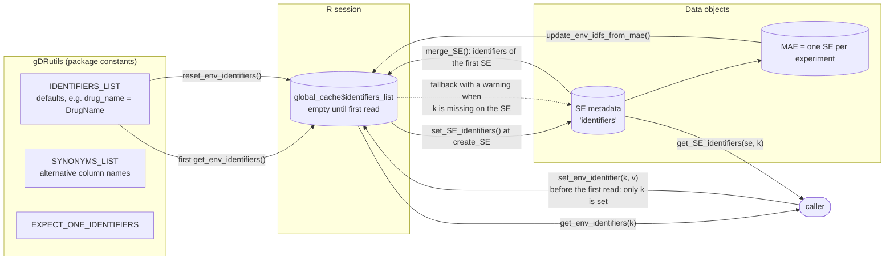
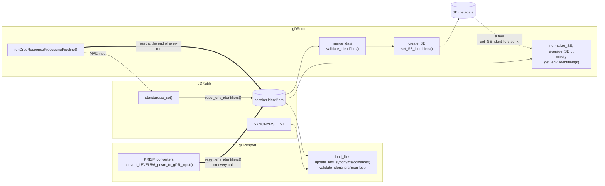

# Identifiers in gDRutils

Identifiers map gDR's logical fields (`drug_name`, `duration`, …) to the column names a dataset
actually uses (`DrugName`, `Duration`, …). Always read them through these functions — never
hardcode a column name.

Source of truth: `R/identifiers_list.R`, `R/global_cache.R`, `R/identifiers.R`, `R/se_metadata.R`,
`R/merge_SE.R`, `R/standardize_MAE.R` and `R/validate_identifiers.R` here, plus the callers named
below in gDRimport and gDRcore. Checked against `main` of gDRutils `d48580a0`, gDRimport `52e7a93`
and gDRcore `bce0cc58`.

## Where the values live

## How the suite uses them

## Things the diagrams make visible

- **Processing reads the session, not the SE.** gDRcore calls `get_env_identifiers()` about 130
  times and `get_SE_identifiers()` 8 times. `average_SE` reads no SE identifiers, and
  `normalize_SE` takes the duration from the SE at `gDRcore/R/normalize_SE.R:105` and from the
  session at `:355`. An SE with custom identifiers keeps them in its metadata, but most of the
  processing still uses the session values.
- **Four places reset the session and do not restore it:** the PRISM converters
  (`gDRimport/R/prism_to_gdrDF.R:37`, `:275`), the end of every pipeline run
  (`gDRcore/R/runDrugResponseProcessingPipeline.R:416`) and `standardize_se()`
  (`R/standardize_MAE.R:44`), which the pipeline calls for MAE input
  (`runDrugResponseProcessingPipeline.R:273`). Identifiers a caller set with
  `set_env_identifier()` are gone after any of them. (`setEnvForPSet()` resets them too, but
  setting them is its documented purpose.)
- **`merge_SE()` writes to the session:** it copies the identifiers of the first SE into it
  (`R/merge_SE.R:173-176`).
- **`set_env_identifier()` before the first read leaves the other identifiers unset.** In a fresh
  session the cache then holds only the identifier that was set, so `get_env_identifiers("duration")`
  returns `NULL`; the defaults are filled in only by a read.
- **Fallback, not failure.** `get_SE_identifiers()` falls back to the session value with a warning
  when an identifier is missing on the SE (`R/se_metadata.R:200-203`), so an old SE can be read
  with today's defaults without anyone noticing.

## Keeping it current

A change to how identifiers are stored, set or read updates these diagrams in the same pull
request, together with the commits above. Diagrams are [Mermaid](https://mermaid.js.org/); GitHub
renders them, and `npx @mermaid-js/mermaid-cli -i identifiers.md -o out.md` checks the syntax
locally.
