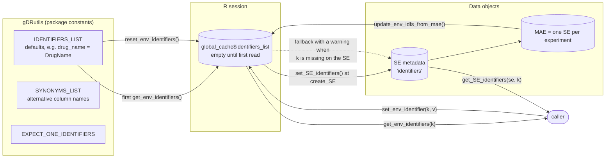
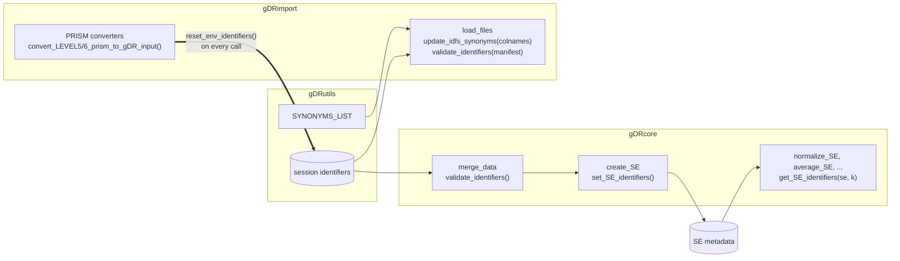

# Identifiers in gDRutils

Identifiers map gDR's logical fields (`drug_name`, `duration`, …) to the column names a dataset
actually uses (`DrugName`, `Duration`, …). Always read them through these functions — never
hardcode a column name.

Source of truth: `R/identifiers_list.R`, `R/global_cache.R`, `R/identifiers.R`, `R/se_metadata.R`
and `R/validate_identifiers.R` here, plus the callers named below in gDRimport and gDRcore.
Checked against `main` of gDRutils `1fb901f8`, gDRimport `74706c9` and gDRcore `bce0cc58`.

## Where the values live

## How the suite uses them

## Things the diagrams make visible

- **Two scopes.** The session cache governs import and validation; once an SE exists, processing
  reads the copy stored on the SE. An SE built with custom identifiers keeps them even after the
  session is reset.
- **The PRISM converters reset the session cache** (`gDRimport/R/prism_to_gdrDF.R:37`, `:210`) and
  do not restore it, so identifiers a caller set with `set_env_identifier()` are gone after one
  PRISM import. (`setEnvForPSet()` resets them too, but setting them is its documented purpose.)
- **Fallback, not failure.** `get_SE_identifiers()` falls back to the session value with a warning
  when an identifier is missing on the SE (`R/se_metadata.R:199-202`), so an old SE can be read
  with today's defaults without anyone noticing.

## Keeping it current

A change to how identifiers are stored, set or read updates these diagrams in the same pull
request, together with the commits above. Diagrams are [Mermaid](https://mermaid.js.org/); GitHub
renders them, and `npx @mermaid-js/mermaid-cli -i identifiers.md -o out.md` checks the syntax
locally.
